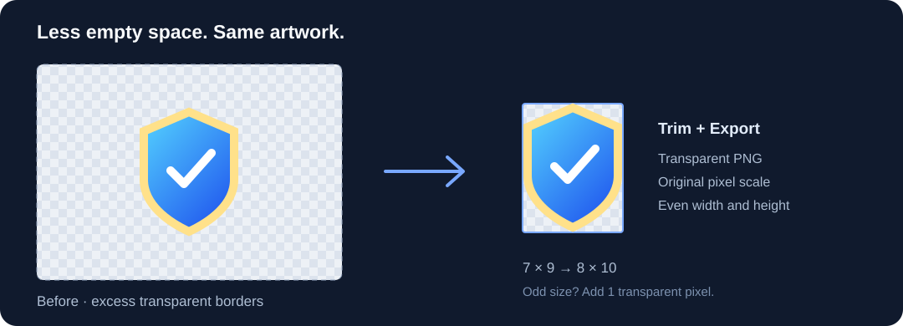

# Unity Asset Trim

[English](README.md) | [简体中文](README.zh-CN.md)

**Trim the active PSD from a dockable Photoshop panel, or batch-export clean PNG assets for Unity.**

Version 1.1.0 adds a UXP panel with three actions: trim the active document's canvas, export a trimmed PNG copy, or open the existing batch window. Keep original pixel scale, optionally enforce even dimensions, and ignore faint alpha noise.



## Download and install

Download **[UnityAssetTrim-Setup-1.1.0.exe](https://github.com/sakeka56/PsPlugin-UnityAssetTrimer/releases/download/v1.1.0/UnityAssetTrim-Setup-1.1.0.exe)** from [Releases](https://github.com/sakeka56/PsPlugin-UnityAssetTrimer/releases/latest).

1. Run the installer. It detects Photoshop installations automatically.
2. Choose your Photoshop installation if more than one is listed, then click **Install / Update**. Accept a Windows administrator prompt if the installation folder requires it.
3. Restart Photoshop and open **Plugins → Unity Asset Trim → Unity Asset Trim**. Dock the panel beside your other Photoshop panels.

The offline installer installs the UXP panel in `Plug-ins/UnityAssetTrim` and the batch script in `Presets/Scripts/Unity Asset Trim.jsx`. Existing versions are backed up. The panel requires Photoshop **24.4 or newer**. No Unity package or extra runtime download is needed on standard Windows 10/11 with .NET Framework 4.8. Normal installation does not enable developer mode.

The installer window can be resized or maximized. Text wraps automatically, and content can scroll when space is limited.

The executable is not code-signed. Windows may show an unknown-publisher or SmartScreen prompt. Download from this repository's Releases page; `SHA256SUMS.txt` is included for checksum verification.

### Portable / manual installation

Download **[UnityAssetTrim-Portable-1.1.0.zip](https://github.com/sakeka56/PsPlugin-UnityAssetTrimer/releases/download/v1.1.0/UnityAssetTrim-Portable-1.1.0.zip)** and extract it. In Photoshop, use **File → Scripts → Browse** to run `Unity Asset Trim.jsx`, or copy that file into Photoshop's `Presets/Scripts` folder and restart Photoshop.

To install the panel manually, copy the ZIP's `uxp` folder to `<Photoshop>/Plug-ins/UnityAssetTrim` and restart Photoshop. Alternatively, download **[UnityAssetTrim-Panel-1.1.0.ccx](https://github.com/sakeka56/PsPlugin-UnityAssetTrimer/releases/download/v1.1.0/UnityAssetTrim-Panel-1.1.0.ccx)** and double-click it to install through Creative Cloud Desktop. The CCX contains the panel only; install the JSX separately for the batch shortcut. The EXE installs both.

## Use

| Panel action | Result |
| --- | --- |
| Trim current document | Changes only the focused document's canvas. Keeps layers, layer identities, mode and bit depth; does not export or save the PSD. One Undo restores the previous canvas. |
| Trim current image and export | Choose a PNG destination. Trims and exports a temporary copy; the active PSD stays unchanged. Cancelling the destination dialog makes no edits. |
| Batch-trim images | Opens the familiar 1.0.1 batch workflow below. Its options are independent of the panel's options. |

Canvas trimming uses `resizeCanvas`, never image resampling. Removing asymmetric margins translates the artwork with the canvas; its pixel scale and proportions stay intact. Even sizing appends a transparent pixel on the right or bottom. Layer content outside the new canvas is outside the visible document area. Review the result before saving your PSD.

### Batch window

1. Select **Choose images** for multiple individual files, or **Choose folder** for a directory. Folder mode can include subfolders and preserves their relative paths on export.
2. Select a separate output folder.
3. Set trim options and click **Trim and export**.

The interface supports **English and Simplified Chinese**. It follows Photoshop's locale on first launch; use the language selector to switch. Switching languages resets the current dialog selections.

| Setting | Default | Behavior |
| --- | --- | --- |
| Keep even dimensions | On | If width or height is odd, append one transparent pixel on the right or bottom. Existing artwork is not rescaled. |
| Ignore edge alpha ≤ | `1` | Ignore pixels with alpha at or below the threshold when finding the crop rectangle. Range: `0–254`. Use `0` for strict nontransparent bounds. |
| Extra transparent padding | `0` | Add this many transparent pixels on every side, then apply the even-dimension rule. Range: `0–4096`. |
| Include subfolders | On | Scan subfolders and preserve directory structure. An output folder inside the input folder is excluded from scanning. |

For example, a **7 × 9** pixel crop becomes **8 × 10** with even dimensions enabled. With two pixels of padding per side, it becomes **12 × 14**.

The alpha threshold changes only the crop rectangle. Semitransparent pixels inside that rectangle retain their alpha values; faint pixels outside it are cropped away. Use a lower threshold for soft glows and shadows.

## Files and output

- Input extensions: PNG, PSD, PSB, TIFF, TGA, WebP, BMP, JPG and JPEG. Availability depends on the formats your Photoshop installation can open.
- Export output: **8-bit RGB PNG**, using the visible appearance of the document. Non-RGB or higher-bit-depth sources are converted only in an export copy. Color profiles are not explicitly converted to sRGB. Canvas-only trimming keeps the original document's layers and color mode.
- No action automatically saves over a source file. The canvas-only action intentionally edits the current document in memory; save it yourself when ready. Export and batch actions preserve source documents.
- Existing output files are preserved. Name collisions receive `_2`, `_3`, and so on.
- Fully transparent images and images with no pixels above the selected threshold are skipped. A failed file does not stop the rest of the batch.
- Each batch writes a UTF-8 TSV log with status, source path, original size, exported size, and output path or error. Stop takes effect after the current image finishes.

## Requirements and limits

- **Windows 10/11** for the installer. Photoshop must already be installed.
- **The panel requires Photoshop 24.4+. Photoshop 2024 / 25.2.0 is tested.** CC 2018 does not support this UXP panel. The separate JSX batch script is retained for ExtendScript workflows, but older Photoshop versions and macOS are not verified.
- This release includes a dockable UXP panel and a separate batch script. Unity is not required.
- Convert an opaque Background layer to a regular layer before requesting extra transparent padding. Multi-artboard documents are not supported for current-document trimming.
- Opaque white, black or colored backgrounds are kept. This tool trims transparency; it does not remove backgrounds.
- Images are cropped independently. Review assets that require shared canvas sizes, fixed pivots, nine-slice borders, animation alignment or atlas coordinates before replacing them in Unity.
- PSD visibility is respected. Layers and artboards are not exported individually. Multi-artboard documents are not a supported export workflow.

## Update and uninstall

Run the newer installer and choose **Install / Update**. Reinstalling the same payload does not create redundant backups.

Updating from 1.0.0 fixes the script dialog reopening after cancellation. Save your work and exit Photoshop before updating, then reopen it so any script already running in memory is cleared.

To uninstall the EXE-installed version, run Setup and choose **Uninstall**, or remove `Plug-ins/UnityAssetTrim` and `Presets/Scripts/Unity Asset Trim.jsx`. Backups remain in `UnityAssetTrim-backups` and beside the JSX as `.backup-*`; restore or remove them manually if needed. CCX installations are managed separately in Creative Cloud Desktop. Restart Photoshop after changes.

## Build from source

No package-manager restore or third-party build tools are required. On Windows, with .NET Framework 4.x and PowerShell:

```powershell
powershell -NoProfile -ExecutionPolicy Bypass -File .\scripts\build.ps1
```

The script uses the .NET Framework C# compiler, embeds the panel and JSX into the installer, verifies the Adobe-generated CCX against current UXP source, and writes the setup EXE, portable ZIP, CCX and SHA-256 checksums into `dist/`. See [packaging](packaging/README.md) when changing panel source.

### Tests

```powershell
node .\tests\unit-tests.cjs
node .\tests\uxp-geometry.cjs
powershell -NoProfile -ExecutionPolicy Bypass -File .\tests\installer-tests.ps1
# Requires Photoshop. Close open documents before running:
powershell -NoProfile -ExecutionPolicy Bypass -File .\scripts\test-photoshop.ps1
```

Installer tests exercise the compiled executable, embedded payload, fresh installation, repeat installation, backups, uninstall protection, Unicode paths and exit codes. Photoshop integration tests generate their own fixtures and verify cropping, parity padding, alpha thresholds, open-document preservation, batch error handling, logs and both interface languages. Photoshop integration tests run locally; CI does not include Photoshop.

Native UXP validation on Photoshop 25.2.0 additionally checked layer identities, matching RGBA pixels, one-step undo, unchanged source PSD after PNG export, focus restoration and the batch-window shortcut. The installed panel was also verified in normal mode after disabling the temporary development environment.

## Support the project

If this tool helps your workflow, you can support its continued development with a voluntary tip. Thank you!


## License

[MIT](LICENSE). Photoshop and Unity are trademarks of their respective owners. This project is independent of Adobe and Unity Technologies.
