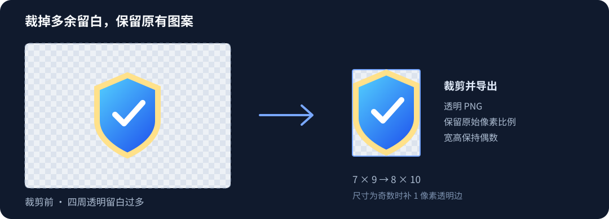

# Unity Asset Trim

[English](README.md) | [简体中文](README.zh-CN.md)

**通过可停靠的 Photoshop 面板裁剪当前 PSD，也能批量导出紧凑的 PNG 游戏资源。**

1.1.0 新增 UXP 插件面板，提供裁剪当前文档、裁剪并导出 PNG 副本、打开原有批量窗口三个入口。保留原有像素比例，可让宽高保持偶数，也能忽略微弱透明杂点。



## 下载与安装

前往 [Releases](https://github.com/sakeka56/PsPlugin-UnityAssetTrimer/releases/latest)，下载 **[UnityAssetTrim-Setup-1.1.0.exe](https://github.com/sakeka56/PsPlugin-UnityAssetTrimer/releases/download/v1.1.0/UnityAssetTrim-Setup-1.1.0.exe)**。

1. 打开安装程序，程序会自动检测 Photoshop 安装位置。
2. 如有多个版本，选择目标 Photoshop，然后点击 **一键安装 / 更新**。目录需要管理员权限时，允许 Windows 的权限提示。
3. 重启 Photoshop，通过 **插件 → Unity Asset Trim → Unity 资源裁剪** 打开面板，可将它停靠在其他面板旁边。

离线 EXE 同时安装 `Plug-ins/UnityAssetTrim` 中的 UXP 面板与 `Presets/Scripts/Unity Asset Trim.jsx` 批量脚本，遇到旧版本会先备份。面板需要 **Photoshop 24.4 或更高版本**。无需安装 Unity 包；标准 Windows 10/11 的 .NET Framework 4.8 即可运行。正常安装不需要开启开发人员模式。

安装窗口支持拖动调整大小和最大化，文字自动换行；空间不足时可滚动查看内容。

当前 EXE 未做代码签名，Windows 可能提示未知发布者或 SmartScreen。请从本仓库的 Releases 下载；发布包同时提供 `SHA256SUMS.txt` 以便校验文件。

### 便携使用 / 手动安装

下载并解压 **[UnityAssetTrim-Portable-1.1.0.zip](https://github.com/sakeka56/PsPlugin-UnityAssetTrimer/releases/download/v1.1.0/UnityAssetTrim-Portable-1.1.0.zip)**。在 PS 中通过 **文件 → 脚本 → 浏览** 运行其中的 `Unity Asset Trim.jsx`；也可以把它复制到 PS 的 `Presets/Scripts` 文件夹，重启后从脚本菜单启动。

手动安装面板时，将 ZIP 中的 `uxp` 文件夹复制为 `<PS安装目录>/Plug-ins/UnityAssetTrim`，然后重启。也可下载 **[UnityAssetTrim-Panel-1.1.0.ccx](https://github.com/sakeka56/PsPlugin-UnityAssetTrimer/releases/download/v1.1.0/UnityAssetTrim-Panel-1.1.0.ccx)**，双击通过 Creative Cloud Desktop 安装。CCX 只包含面板，批量快捷入口还需要另行安装 JSX；EXE 会同时安装两者。

## 使用方法

| 面板操作 | 行为 |
| --- | --- |
| 裁剪当前文档 | 直接调整当前聚焦文档的画布，保留图层、图层身份、颜色模式和位深；不导出、不自动保存 PSD，可一次撤销。 |
| 裁剪当前图片并导出 | 选择 PNG 保存位置，在临时副本中裁剪并导出，当前 PSD 不变。取消保存位置选择时不作修改。 |
| 批量裁剪图片 | 打开下方熟悉的 1.0.1 批量流程，其选项与面板选项独立。 |

画布裁剪只调用画布尺寸接口，不缩放图像。裁掉不对称留白时，图案随画布原点平移，像素比例不变；偶数补边位于右侧或底部。新画布以外的图层内容不再显示在文档可见区域，请检查结果后再自行保存 PSD。

### 批量窗口

1. 点击 **选择多张图片**，或点击 **选择文件夹**。文件夹模式可包含子文件夹，导出时保留相对目录结构。
2. 选择独立的输出文件夹。
3. 设置裁剪选项，点击 **开始批量裁剪**。

界面支持 **简体中文与 English**。首次打开时跟随 Photoshop 语言，也可通过顶部语言下拉框切换。切换语言会重置当前对话框的选择。

| 选项 | 默认值 | 行为 |
| --- | --- | --- |
| 宽高保持偶数 | 开启 | 某一边为奇数时，在右侧或底部补 1 像素透明边；不缩放已有图案。 |
| 忽略边缘 Alpha ≤ | `1` | 寻找裁剪范围时忽略 Alpha 不大于此值的像素。范围 `0–254`；`0` 表示严格保留所有非透明像素。 |
| 额外透明留边 | `0` | 每侧增加指定像素的透明边，再应用偶数补边。范围 `0–4096`。 |
| 包含子文件夹 | 开启 | 递归扫描并保留目录结构。输出文件夹位于输入目录内部时，会从扫描中排除。 |

例如，图案边界为 **7 × 9** 像素，开启偶数选项后导出为 **8 × 10**；每侧额外留边 2 像素后，导出为 **12 × 14**。

Alpha 阈值仅决定裁剪范围。范围内原有半透明像素的 Alpha 不变；范围外的微弱像素会随边缘一起裁掉。带柔和光晕或阴影的素材建议使用较低阈值。

## 文件与导出行为

- 输入扩展名：PNG、PSD、PSB、TIFF、TGA、WebP、BMP、JPG、JPEG；具体可用格式取决于 Photoshop 的打开能力。
- 导出统一使用 **8 位 RGB PNG**，采用当前可见外观。非 RGB 或高位深图片只在导出副本中转换模式与位深，不主动将配置文件转换为 sRGB。仅裁剪画布时保留原文档图层与颜色模式。
- 所有操作均不自动覆盖保存源文件。“裁剪当前文档”会按预期修改内存中的当前文档，由你确认后保存；导出及批量操作保留源文档。
- 不覆盖已有导出文件，同名自动追加 `_2`、`_3` 等编号。
- 全透明图片或阈值下无有效像素的图片会跳过；单张失败不影响后续处理。
- 每批生成 UTF-8 TSV 日志，记录状态、源路径、原尺寸、导出尺寸及输出路径或错误。停止操作在当前图片处理结束后生效。

## 环境要求与使用范围

- 安装程序适用于 **Windows 10/11**，需要事先安装 Photoshop。
- 面板需要 **Photoshop 24.4+**，已实测 **Photoshop 2024 / 25.2.0**。CC 2018 不支持此 UXP 面板。独立 JSX 批量脚本继续保留，但旧版 Photoshop 与 macOS 尚未验证。
- 本版包含可停靠 UXP 面板与独立批量脚本，无需安装 Unity。
- 不透明的“背景”图层需要先转换为普通图层，才能额外增加透明留边。当前文档裁剪不支持多画板文档。
- 不透明的白色、黑色等背景不会被删除。本工具裁掉透明留白，不执行抠图。
- 每张图片独立计算边界。统一画布、固定 Pivot、九宫格边框、连续动画或图集坐标相关资源，替换前请检查其布局约定。
- PSD 按当前可见状态处理，不按图层或画板逐个导出；多画板文档不属于本工具支持的导出流程。

## 更新与卸载

运行新版安装器，点击 **一键安装 / 更新**。相同版本重复安装不会产生冗余备份。

从 1.0.0 升级可修复脚本取消后重复弹窗的问题。请先保存工作并退出 Photoshop，再安装新版，之后重新打开 PS，清除仍在内存中执行的旧脚本。

卸载 EXE 安装的版本时，打开安装器选择卸载，或手动删除 `Plug-ins/UnityAssetTrim` 与 `Presets/Scripts/Unity Asset Trim.jsx`。面板备份位于 `UnityAssetTrim-backups`，脚本旁保留 `.backup-*`，可按需还原或删除。CCX 安装的面板由 Creative Cloud Desktop 单独管理。更改后请重启 PS。

## 从源码构建

Windows 环境安装 .NET Framework 4.x、PowerShell 后即可构建，无需包管理器还原或第三方构建工具：

```powershell
powershell -NoProfile -ExecutionPolicy Bypass -File .\scripts\build.ps1
```

构建脚本使用 .NET Framework 的 C# 编译器，将面板与 JSX 嵌入安装器，并核对 Adobe 官方工具生成的 CCX 与当前 UXP 源码一致，在 `dist/` 中生成 EXE、便携 ZIP、CCX 与 SHA-256 校验文件。修改面板源码时请参阅[打包说明](packaging/README.md)。

### 测试

```powershell
node .\tests\unit-tests.cjs
node .\tests\uxp-geometry.cjs
powershell -NoProfile -ExecutionPolicy Bypass -File .\tests\installer-tests.ps1
# 需要 Photoshop；运行前请关闭已打开的文档：
powershell -NoProfile -ExecutionPolicy Bypass -File .\scripts\test-photoshop.ps1
```

安装测试验证实际 EXE、嵌入文件、首次安装、重复安装、备份、卸载保护、中文路径和退出码。Photoshop 集成测试自行生成素材，验证裁剪、偶数补边、Alpha 阈值、已打开文档保护、批次错误处理、日志及两种界面语言。Photoshop 集成测试在本地运行，CI 环境不包含 Photoshop。

另已在 Photoshop 25.2.0 的真实 UXP 环境核对图层身份、对应 RGBA 像素、单步撤销、PNG 导出后原稿不变、焦点恢复及批量快捷入口；临时开发环境关闭后，也验证了正式安装面板在普通模式下可被识别。

## 赞助支持

如果这个工具对你有帮助，欢迎自愿扫码赞赏，支持后续维护与开发。感谢支持！


## 许可证

[MIT](LICENSE)。Photoshop 和 Unity 商标归各自所有者所有；本项目独立于 Adobe 与 Unity Technologies。
